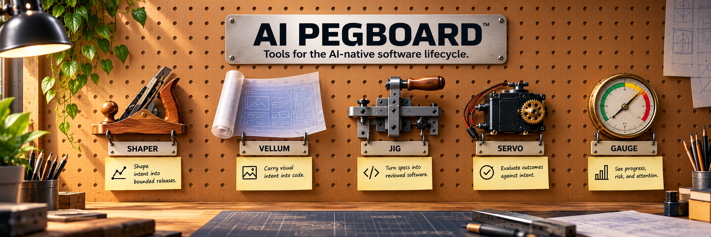

**Tools for the AI-native software lifecycle.**

AI Pegboard brings together a set of focused tools for the everyday work of building software with AI — shaping what to build, carrying design intent into code, implementing it rigorously, proving the result, and seeing where attention is needed.

Each tool owns a different part of the loop.

| Tool | Role | What it does | Status |
| --- | --- | --- | --- |
| **[shaper](https://github.com/ramboz/shaper)** | **Shape** | Turn intent into bounded releases. | Available |
| **vellum** | **Design** | Carry visual intent into code with measurable fidelity. | Coming soon |
| **[jig](https://github.com/ramboz/jig)** | **Build** | Turn specs into reviewed software. | Available |
| **[servo](https://github.com/ramboz/servo)** | **Prove** | Evaluate outcomes against intent and produce evidence. | Available |
| **gauge** | **Steer** | See progress, risk, blockers, and where attention is needed. | Coming soon |

```text
SHAPE        DESIGN        BUILD         PROVE
shaper       vellum        jig           servo
   │            │           │              │
   └────────────┴───────────┴──────────────┘
                       │
                     gauge
                     STEER
```

This isn't a rigid pipeline. The tools compose where they are useful, and feedback flows between them.

## The tool wall

### shaper — shape the work

> What should we build, and how much of it?

Shaper turns product intent into bounded releases. It helps establish appetite, decide what fits above or below the cutline, identify risks and no-gos, and define what must be true for a release to count as successful.

Shaper operates above implementation: it decides the shape of the work before that work becomes specs and slices.

_Shape intent into bounded releases._

### vellum — preserve design intent

> What should the interface look like, exactly?  
> (Coming soon to AI Pegboard.**)

Vellum covers the design side of the AI build loop. It carries an interface from brief and design through measurable redlines, implementation, and fidelity review.

Instead of asking an implementation agent to eyeball a mockup, Vellum turns an accepted design into a measurable contract and drives the build toward it.

```text
BRIEF & DESIGN → REDLINE ⇄ BUILD → VERIFY
```

Vellum can work independently, but is designed to compose especially well with Jig and Servo:

```text
Design AI → vellum → jig → servo
```

Vellum preserves the visual intent, Jig structures the implementation, and Servo supplies evaluation evidence.

Vellum is under active development and **is not yet distributed through Pegboard**. It will join the tool wall in a future release.

_Carry visual intent into code._

### jig — build with discipline

> How do we turn intent into working software without losing the plot?

Jig provides the implementation workflow: specs, vertical slices, test-driven development, review, reconciliation, and landing.

It gives AI-assisted development durable structure so that implementation state lives in the repository rather than disappearing into a conversation.

_Turn specs into reviewed software._

### servo — prove the outcome

> Did what we built actually achieve what we intended?

Servo turns success criteria into executable evaluation. It combines deterministic checks and model-based judgment where appropriate, runs guarded evaluation loops, and records evidence behind the result.

Other Pegboard tools can compose with Servo rather than inventing their own evaluation systems — Vellum, for example, uses Servo to measure interface fidelity.

_Evaluate outcomes against intent._

### gauge — know where to look

> Across all this work, what needs attention?  
> (Coming soon to AI Pegboard.**)

Gauge provides the higher-level view across projects and milestones. It surfaces progress, risk, blockers, cost, velocity, and the work that most needs human attention.

Where the other tools operate inside individual pieces of the development lifecycle, Gauge helps you see and steer the system around them.

_See progress, risk, and attention._

## One workshop, different tools

Pegboard isn't trying to turn the software lifecycle into one giant agent or one prescribed workflow.

The tools deliberately operate at different levels:

```text
Release / product intent     →  shaper
Visual intent                →  vellum
Change / implementation      →  jig
Outcome / evidence           →  servo
Project / portfolio          →  gauge
```

Use the tools you need.

A backend change might use Jig and Servo without Vellum. A UI feature might use Vellum, Jig, and Servo together. Shaper can sit above either when the work needs to be bounded into a release, while Gauge provides visibility across the work already underway.

The common idea is simple:

```text
intent → explicit artifacts → disciplined execution → evidence → human steering
```

The pegboard is the workshop wall where those tools live.

## Available today

Pegboard currently distributes:


| Plugin | What it does | Claude Code | Codex | Copilot CLI |
|---|---|:-:|:-:|:-:|
| [jig](https://github.com/ramboz/jig) | Spec-driven, review-enforced, hook-gated AI-native development workflow: scaffold a project, split specs into slices, implement with TDD, review independently, reconcile, land. | ✓ | ✓ | ✓ |
| [servo](https://github.com/ramboz/servo) | Closed-loop scaffolder for unattended agent operations: oracle scoring, headless agent loops, hooks, and worktree races — tailored to each project's signals. | ✓ | ✓ | ✓ |
| [shaper](https://github.com/ramboz/shaper) | Release shaping before implementation starts: appetite, shaped bets, release cutlines, no-gos, and handoff guidance into specs. | ✓ | ✓ | ✓ |

**vellum and gauge are coming soon.** Its place on the tool wall is shown here because it fills the design-to-code part of the lifecycle, but it is not yet wired into this marketplace.

## Install

Register the marketplace once per host, then install plugins as `name@ai-pegboard`.

**Claude Code**

```text
/plugin marketplace add ramboz/ai-pegboard
/plugin install jig@ai-pegboard
```

**Codex**

```bash
codex plugin marketplace add ramboz/ai-pegboard
codex plugin add jig@ai-pegboard
```

**GitHub Copilot CLI**

```bash
copilot plugin marketplace add ramboz/ai-pegboard
copilot plugin install jig@ai-pegboard
```

Swap `jig` for any plugin in the table below. A plugin only appears in a
host's descriptor when its repository ships a committed package for that host,
so `codex plugin list` / `copilot plugin marketplace browse ai-pegboard` show
exactly what will install.

## What's next

The pegboard is meant to grow.

Vellum and Gauge are the next tools planned for integration, bringing the design-to-code fidelity workflow and project portfolio monitoring into the same tool wall as Shaper, Jig, Servo.

Empty space on the board is intentional. There are more jobs in the AI-native software lifecycle worth building good tools for.
